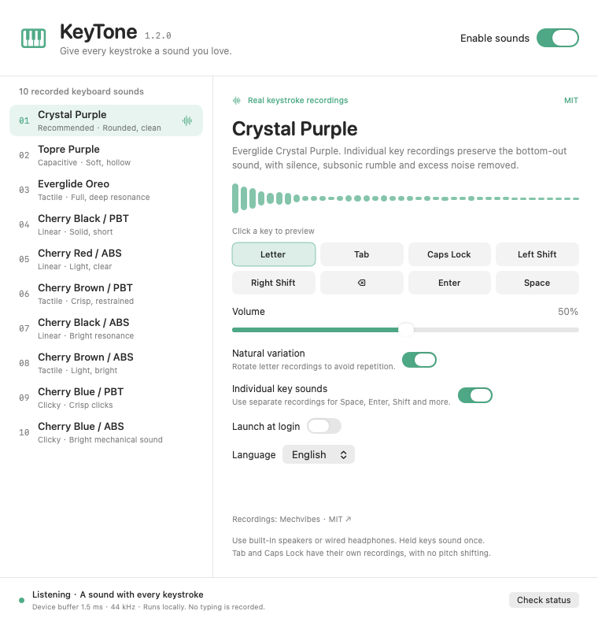

# KeyTone

> **Moved to [Xiaoyao-Ren/toys](https://github.com/Xiaoyao-Ren/toys/tree/main/keytone).** This repository is archived and no longer updated.

**A tiny macOS menu bar app that gives your keyboard the sound of a mechanical keyboard.**

English · [简体中文](README.zh-CN.md)



## Features

- **10 recorded keyboard sounds:** Everglide Crystal Purple, Topre Purple, Everglide Oreo, and Cherry MX Black, Red, Brown and Blue variants with ABS/PBT keycaps.
- **Low-latency playback:** preloaded samples, a dedicated input listener and native Core Audio mixing. The app requests a 64-frame output buffer where supported.
- **Individual key sounds:** separate recordings for Tab, Caps Lock, both Shift keys, Backspace, Enter and Space. Turn this off to use ordinary-key sounds for every key.
- Adjustable volume, natural variation, key previews and optional launch at login.
- **中文 / English** interface, with your language choice saved automatically.
- Runs in the menu bar when the window is closed. No account, network connection or typing logs.
- Native Swift/SwiftUI and C; the built app is about **2 MB**.

## Requirements and use

**Apple Silicon Mac · macOS 13 or later.** The build script currently targets arm64.

1. Build the app using the instructions below, then copy `dist/KeyTone.app` to your Applications folder and open it.
2. Choose a sound and click the preview keys to try it.
3. Turn on **Enable sounds**, then allow KeyTone in **System Settings → Privacy & Security → Input Monitoring**. Quit and reopen if macOS asks you to.
4. Choose **Language** in the settings window to switch between English and Chinese.

Closing the window keeps KeyTone running. Use its menu bar icon to pause sounds, reopen settings or quit. A held key sounds once rather than repeating. Built-in speakers or wired headphones work best; Bluetooth adds latency.

If previews work but typing is silent, click **Check status** to check permission and the running app’s location. macOS Secure Input can temporarily prevent keyboard events from reaching the app. KeyTone does not record typed text or keystroke sequences.

## Build and test

You need Apple Command Line Tools and Python 3. No third-party runtime is bundled with the app. The `cryptography` Python package is only needed to create your local signing identity once.

```sh
git clone https://github.com/Xiaoyao-Ren/KeyTone.git
cd KeyTone
xcode-select --install  # Skip if Command Line Tools are already installed.
python3 -m venv .venv
source .venv/bin/activate
python3 -m pip install cryptography
python3 scripts/setup_signing.py
./build.sh
./test.sh
```

The app is written to `dist/KeyTone.app`; build and test files stay in `.build/`. All final audio samples are included, so building does not download sound packs.

The signing identity stays outside the repository in `~/Library/Application Support/KeyTone/Signing`. Keep it private and retain it for future builds: replacing the identity can require granting Input Monitoring again. Set `KEYTONE_SIGNING_CONFIG` to use an existing identity configuration. Build output paths can be overridden with `KEYTONE_BUILD_DIR` and `KEYTONE_APP_PATH`.

Local builds are self-signed, not Apple Developer ID notarized releases. macOS may ask you to allow an app you built to open.

## License and credits

KeyTone is released under the [MIT License](LICENSE).

Keyboard recordings and key mappings come from [Mechvibes](https://github.com/hainguyents13/mechvibes/tree/16afce45bd7cf12be399e2d1a8d20f221067f534/soundpacks/keyboard), also under MIT. Their original copyright notice is preserved in [LICENSE-Mechvibes.txt](Resources/LICENSE-Mechvibes.txt). The included WAV files are processed from the upstream recordings; they are not claimed to be lossless original masters. Source links and processing details are in [SOURCES.md](Resources/SOURCES.md), [sources.json](Resources/sources.json) and [sample-audit.json](Resources/sample-audit.json).
