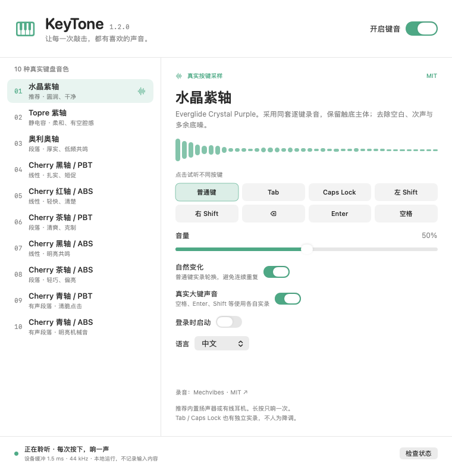

# KeyTone

**一个小巧的 macOS 菜单栏软件，让你的键盘敲出机械键盘的声音。**

[English](README.md) · 简体中文



## 功能

- **10 种真实键盘音色**：水晶紫轴、Topre 紫轴、奥利奥轴，以及 Cherry 黑轴、红轴、茶轴、青轴的不同 ABS/PBT 键帽录音版本。
- **低延迟播放**：预先载入采样，独立线程监听按键，使用原生 Core Audio 混音；设备支持时请求 64 帧输出缓冲。
- **真实按键差异**：Tab、Caps Lock、左右 Shift、退格、Enter 和空格使用各自的实录；也可以关闭此功能，让所有按键使用普通键声音。
- 音量调节、自然变化、逐键试听，以及可选的登录启动。
- **中文 / English** 界面，切换后自动记住选择。
- 关闭窗口后继续在菜单栏运行，无需账号、联网，不记录输入内容。
- 使用原生 Swift/SwiftUI 和 C，构建后的应用约 **2 MB**。

## 环境与使用

**Apple Silicon Mac · macOS 13 或更新版本。** 当前构建脚本面向 arm64。

1. 按下方步骤构建，将 `dist/KeyTone.app` 复制到“应用程序”文件夹后打开。
2. 选择音色，点击按键按钮试听。
3. 打开“开启键音”，到 **系统设置 → 隐私与安全性 → 输入监控** 中允许 KeyTone；如果系统要求，退出后重新打开。
4. 在设置窗口的“语言”中选择中文或 English。

关闭窗口后仍会运行，可通过菜单栏图标暂停、打开设置或退出。长按一个键只响一次，不跟随系统的重复输入连续播放。推荐内置扬声器或有线耳机，蓝牙会增加延迟。

如果试听有声但打字无声，点击“检查状态”，核对权限和当前运行的应用位置。macOS 的安全输入功能可能暂时屏蔽按键事件。KeyTone 不记录文字内容或按键序列。

## 构建与测试

需要 Apple Command Line Tools 和 Python 3。应用不捆绑第三方运行时；Python 的 `cryptography` 包只用于首次创建本地签名身份。

```sh
git clone https://github.com/Xiaoyao-Ren/KeyTone.git
cd KeyTone
xcode-select --install  # 已安装 Command Line Tools 时跳过。
python3 -m venv .venv
source .venv/bin/activate
python3 -m pip install cryptography
python3 scripts/setup_signing.py
./build.sh
./test.sh
```

应用输出到 `dist/KeyTone.app`，构建和测试文件放在 `.build/`。源码已包含全部最终音效采样，正常构建不需要下载音源。

签名身份保存在仓库外的 `~/Library/Application Support/KeyTone/Signing`。请保密并留存，后续构建继续使用；更换签名身份可能需要重新授权输入监控。已有签名配置可通过 `KEYTONE_SIGNING_CONFIG` 指定。`KEYTONE_BUILD_DIR` 和 `KEYTONE_APP_PATH` 可修改构建及应用输出位置。

本地构建使用自签名，并非经过 Apple Developer ID 公证的发行版；macOS 可能要求允许打开你构建的应用。

## 协议与致谢

KeyTone 使用 [MIT 协议](LICENSE) 开源。

键盘录音与键位配置来自同样使用 MIT 协议的 [Mechvibes](https://github.com/hainguyents13/mechvibes/tree/16afce45bd7cf12be399e2d1a8d20f221067f534/soundpacks/keyboard)，原始版权声明保留在 [LICENSE-Mechvibes.txt](Resources/LICENSE-Mechvibes.txt)。仓库中的 WAV 文件由上游录音处理而来，不宣称是无损原始母带。完整出处和处理说明见 [SOURCES.md](Resources/SOURCES.md)、[sources.json](Resources/sources.json) 和 [sample-audit.json](Resources/sample-audit.json)。
